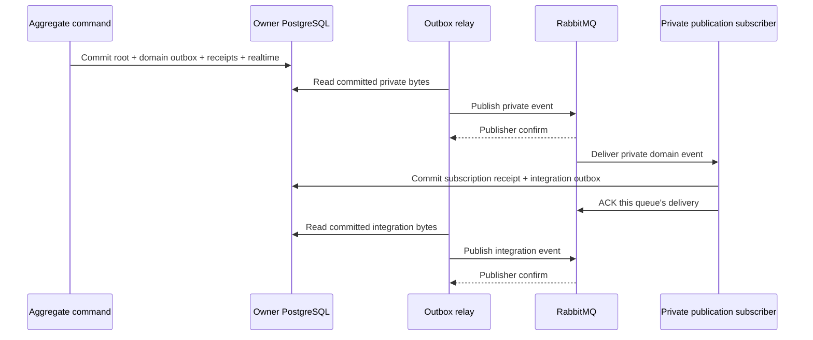

# 0019 — Durable domain events before integration publication

Accepted: 2026-10-14.

## Decision

Aggregates collect plain, context-owned `*DomainEvent` facts during business
transitions. They perform no broker or database I/O. The named write repository's
adaptor selects facts with asynchronous subscribers and stages their private
encodings. The central command executor commits the aggregate, command outcome,
receipts, private event bytes, dispatch intents and realtime bytes together.
Rejected and unchanged transitions create no new facts. Rehydration starts with
an empty event collection; each command invocation receives a fresh aggregate.
Facts without asynchronous subscribers may remain in memory.

A dedicated `*DomainEventHandler` translates each externally relevant fact to a
plain generated `*IntegrationEvent` DTO. It uses `DurablePublicationPort`, whose
PostgreSQL adaptor atomically commits that subscription's receipt, exact outgoing
integration event bytes and dispatch intent in the producing context database.
This handler changes no aggregate and requires no command. Aggregate-changing
reactions continue to enqueue owner commands through `DurableCommandPort`.
Projection handlers retain their existing receipt/projection transaction.

Each private subscription owns a RabbitMQ queue, retry queues and dead-letter
queue. The consumer acknowledges that queue's delivery after the receipt/outbox
transaction commits. Another subscriber has its own delivery and receipt.
Consumers sharing one queue compete for the same subscription's deliveries.
The ACK records completion of the subscription's durable work. A relay separately
publishes the staged integration bytes and waits for a RabbitMQ publisher confirm.
PostgreSQL commits, consumer ACKs and publisher confirms are separate operations.

The integration envelope retains the source aggregate identity and revision,
correlation and occurrence time. Its causation is the private event ID; it has a
new message ID. The handler maps the immutable delivered fact, so publication
remains correct when the current aggregate has advanced. Receipt keys are
`(consumer, source event ID)`, with the original-byte fingerprint and target.
Concurrent copies serialise on that receipt identity. A repeated delivery returns
the recorded outcome and retains the original outgoing bytes. Conflicting bytes
or target fail; correlation IDs never deduplicate delivery.

## Subscriptions and compatibility

| Private event                       | Publication subscriber               | Integration event            |
| ----------------------------------- | ------------------------------------ | ---------------------------- |
| `menu.edition-published.domain`     | `menu.publish-edition-published`     | `menu.edition-published`     |
| `ordering.order-placed.domain`      | `ordering.publish-order-placed`      | `ordering.order-placed`      |
| `preparation.drinks-ready.domain`   | `preparation.publish-drinks-ready`   | `preparation.drinks-ready`   |
| `collection.pickup-opened.domain`   | `collection.publish-pickup-opened`   | `collection.pickup-opened`   |
| `collection.order-collected.domain` | `collection.publish-order-collected` | `collection.order-collected` |
| `loyalty.reward-issued.domain`      | `loyalty.publish-reward-issued`      | `loyalty.reward-issued`      |

Owner `subscriptions.json` entries declare `publication` for these private
reactions. Aggregate reactions declare `command`; Go projections omit both.
Generation checks that publication subscriptions consume private facts and produce
an integration event with the same owner and aggregate kind. Composition validates
the complete consumer set before workers start. The existing private drink,
earned-grant and notification subscriptions retain their identities and roles.

The explicit suffixes apply to domain types and generated plain integration DTOs.
Published Protobuf message names, routing names, versions, field numbers and
historical bytes retain their identities. Existing private Protobuf names and
fixtures also remain compatible. New private messages use additive fields and
owner-local schemas; they have no public compatibility promise. Historical
comparison and fixed private fixtures protect bytes already queued. There is no
schema migration or change to current-state persistence.

## Trade-offs and enforcement

A root can be committed while its integration publication is pending. That state
is permitted, observable through outbox/worker diagnostics and recoverable through
the existing bounded retry, dead-letter and replay mechanisms. This adds a private
delivery and a second database transaction before external consumers can react.
Realtime still commits with the root and can arrive before integration publication.

Repository wrappers reject direct integration staging during an aggregate save.
Native negative tests enforce this boundary. Contract tests reject foreign or
ambiguous publication declarations and verify explicit DTO names without changing
wire identities. Real PostgreSQL tests force a failure on the final receipt insert
and verify that outgoing bytes and dispatch roll back. They also cover concurrent
redelivery, exact-byte reuse and independent receipts. RabbitMQ tests exercise a
lost ACK and separate subscription delivery; the complete workflow lane traverses
all six publication subscriptions.

This refines decisions 0001, 0011, 0015 and 0017. Their command entry points,
transaction ownership, generated contracts and durable delivery guarantees remain
in force.
