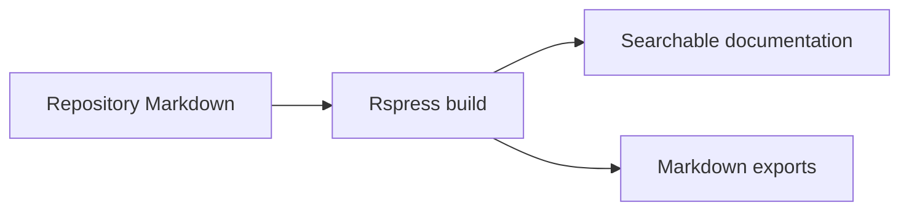

# Documentation site

The repository uses **Rspress 2.0.23**. Markdown stays alongside the code and
guides it describes; edit the existing file to update both the repository and site.
Node.js 24 and the repository's pinned pnpm version are sufficient to run the site.

## Run and check

Run these commands from the repository root:

```sh
pnpm install --frozen-lockfile
pnpm docs:dev       # http://127.0.0.1:3001, with live reload
pnpm docs:check     # Types, lint, link regression tests and static build
pnpm docs:preview   # Serve the most recent build on the same port
```

`pnpm docs:build` builds the site alone. Output goes to
`.local/docs/generated/`, including HTML, per-page Markdown, `llms.txt` and
`llms-full.txt`. The generated files and `.rspress/` cache are ignored by Git.
Run development and preview separately because they share a port.
Restart preview after rebuilding. Development excludes dependency, generated and
local artefact directories from its file watcher to keep repository-root watching
within normal operating-system file limits.

`pnpm check` and `pnpm verify` include documentation checks. The existing CI
verification job runs them on pull requests. No publishing workflow is configured.

## Authoring and navigation

The [Education section](education/index.md) teaches the architectural concepts
through a numbered learning path, diagrams, code references and exercises. Keep
general principles distinct from this repository's particular conventions, and
link implementation claims to their source or accepted decision.

Each [concept page](education/concepts/index.md) includes code snippets and actual
source links. For a construct readers need to create, provide an ordered recipe:
prerequisites, exact files to edit, handwritten and generated responsibilities,
imports, wiring and executable verification. Trace each identifier to its source
and show how data reaches the next component. The [command recipe](education/concepts/commands.md)
demonstrates this format across all three languages.

Mark copied excerpts with `source="relative/path/to/file"` on the
code fence and add a readable Markdown source link. `pnpm docs:check` compares
each marked excerpt with the checkout, allowing whitespace changes, and requires
at least one source-backed example and snippets in Go, Python and TypeScript per
concept. Keep excerpts contiguous; use
separate blocks when explaining distant parts of a file. Label illustrative
examples explicitly and omit `source` for those blocks.

Use ordinary Markdown with one descriptive H1. Keep existing relative links to
other Markdown files, source files and directories. During the build:

- Markdown links stay within the site.
- Directories with a README link to that documentation page.
- Other files and directories link to GitHub on `main`.
- Missing repository targets fail the build; Rspress checks document routes.

Code links on GitHub reflect `main`; run the local tools or open the checkout to
inspect uncommitted source changes. Source paths, query strings and anchors are
preserved by the link transform.

The [site configuration](../rspress.config.ts) defines the route exclusions and
the [navigation module](../scripts/docs/navigation.ts) groups the guides.
Bounded contexts come from [the context catalogue](contexts.json); decision
titles are discovered from their Markdown files. Add other new guides to the
appropriate navigation group. Rspress discovers their pages and search entries.

## Mermaid diagrams

Write standard fenced diagrams. The stable `rspress-plugin-mermaid` 1.0.3 plugin
renders SVGs in the browser, supports light/dark mode and uses Mermaid 10 syntax.



Diagrams require browser JavaScript. The Markdown exports retain their Mermaid
source. Builds need no Mermaid CLI or Chromium installation. When changing a
diagram, inspect its rendered page in both themes; a successful static build
alone does not validate browser rendering.

See [decision 0025](decisions/0025-repository-documentation-site.md) for the
tooling choice and verification boundaries.
