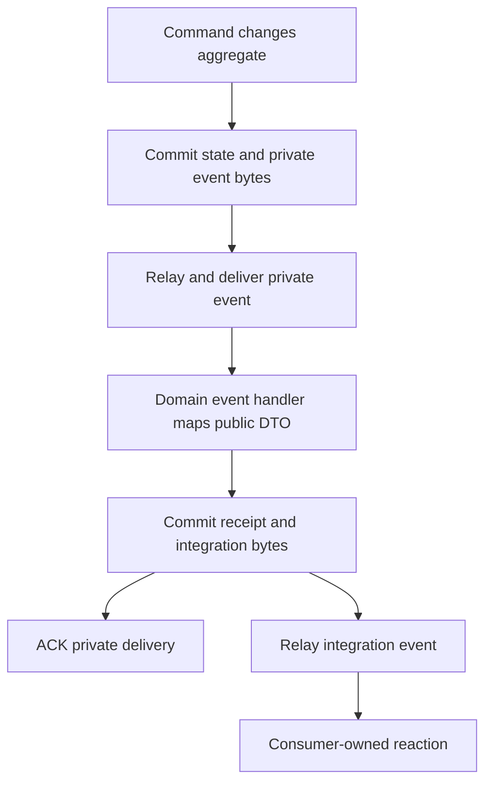

# Integration events

An integration event is an owner-published fact intended for other contexts.
Its schema, identity and compatibility rules form a public contract. Its payload
is a generated plain DTO, distinct from the private domain fact that caused it.

## Creation recipe

1. Decide the public fact's owner, immutable terms and consumer needs. Add its payload to `contracts/<context>/messaging/integration_events/v1/`.
2. Annotate the Protobuf message with stable event name, owner, aggregate kind and contract version. Add identity/range/required constraints used by the generated boundary validators.
3. Run `pnpm generate:contracts`. Review generated plain DTOs, codec registrations, typed publication factories and message identifiers; generation does not supply business mappings.
4. Implement an owner [domain-event handler](domain-event-handlers.md) that maps its delivered private fact and calls `IntegrationEventBusPort`. Add and bind its `publication` subscription.
5. Add consumer subscriptions only where there is an explicit reaction. Aggregate changes enqueue commands; projections update consumer-owned read state; browser messages require a declared realtime handler.
6. Preserve original source revision/time and causation. Test schema compatibility, mapping, exact-byte persistence and receipt/outbox atomicity. Follow [integration handlers](integration-event-handlers.md) and [realtime](realtime-events.md) for the receiving side.

Follow the [end-to-end recipe](../end-to-end-recipe.md) to connect this step to the complete workflow.

## Generate the contract, write the mapping

The owner Protobuf declaration supplies the public identity, aggregate kind,
version and field constraints. For example:

### Protobuf

Source: [ordering_integration_events.proto](../../../contracts/ordering/messaging/integration_events/v1/ordering_integration_events.proto).

```protobuf source="../../../contracts/ordering/messaging/integration_events/v1/ordering_integration_events.proto"
message OrderPlaced {
  option (cafe.events.event) = { name: "ordering.order-placed" owner: "ordering" kind: "order" version: 1 };
  string order_id = 1 [(cafe.events.rules) = { uuid: true source_identity: true }];
  string customer_id = 2 [(cafe.events.rules) = { uuid: true }];
  string edition_id = 3 [(cafe.events.rules) = { uuid: true }];
  string currency = 4 [(cafe.events.rules) = { pattern: "^[A-Z]{3}$" }];
  repeated Line lines = 5 [(cafe.events.rules) = { min_items: 1 max_items: 5 }];
}
```

`pnpm generate:contracts` emits DTOs, typed identifiers, codec registrations and
publication factories for each selected language service. The generator cannot
infer business mapping from a domain object. The owner writes that mapping in
its [domain event handler](domain-event-handlers.md).

## Bind the typed publication factory

These excerpts give the handler its durable publication port. The port knows the
owner database, subscription, aggregate kind and generated public contract factory.

### Go

Source: [ordering.go](../../../services/storefront/apps/storefront/di/ordering.go).

```go source="../../../services/storefront/apps/storefront/di/ordering.go"
func(s *support.StorefrontRuntime) reactions.OrderPlacedDomainEventHandler {
	return reactions.OrderPlacedDomainEventHandler{Publications: store.NewPublicationOutbox[model.OrderPlacedIntegrationEvent](s.Databases["ordering"], names.OrderingSubscriptionPublishOrderPlaced.String(), "order", codec.PublishOrderPlaced)}
},
```

### Python

Source: [preparation.py](../../../services/operations/src/operations/apps/composition/preparation.py).

```python source="../../../services/operations/src/operations/apps/composition/preparation.py"
    drinks_ready_publications = providers.Singleton(
        PostgresPublicationOutbox,
        database,
        PreparationSubscription.PUBLISH_DRINKS_READY,
        "ticket",
        publish_DrinksReady,
    )
    realtime_bus = providers.Singleton(
        PostgresRealtimeEventBus, database, PreparationSubscription.REALTIME_DRINKS_READY, "ticket"
    )
    realtime_drinks_ready = providers.Singleton(
        DrinksReadyRealtimeDomainEventHandler, ticket_read_repository, realtime_bus
    )
    publish_drinks_ready = providers.Singleton(DrinksReadyDomainEventHandler, drinks_ready_publications)
```

### TypeScript

Source: [loyalty.ts](../../../services/engagement/src/apps/composition/loyalty.ts).

```ts source="../../../services/engagement/src/apps/composition/loyalty.ts"
publishIssued: asFunction(
  (c: LoyaltyDependencies) =>
    new RewardIssuedDomainEventHandler(
      new PostgresPublicationOutbox(
        c.database,
        LoyaltySubscription.PUBLISH_REWARD_ISSUED,
        'reward',
        (payload) => published(LoyaltyIntegrationEvent.REWARD_ISSUED, payload),
      ),
    ),
).singleton(),
```

## The complete runtime sequence



The integration publication keeps the original source revision and occurrence
time. Its causation points to the private event; its own message identity identifies
this new publication. The subscriber's receipt prevents repeating that publication
transaction after a duplicate private delivery.

## Evolve deliberately

Change the owner schema and mapping together, regenerate outputs and verify
historical fixtures. Retain field numbers and historical wire identities. Consumers
declare their subscriptions and validate their own incoming representation.
See [contracts and generation](contracts-and-generation.md) for the file locations.

## Related concepts

[Domain events](domain-events.md) · [Domain event handlers](domain-event-handlers.md) · [Integration event handlers](integration-event-handlers.md) · [Contracts and generation](contracts-and-generation.md)

[Concept catalogue](index.md) · [Learning path](../index.md)
