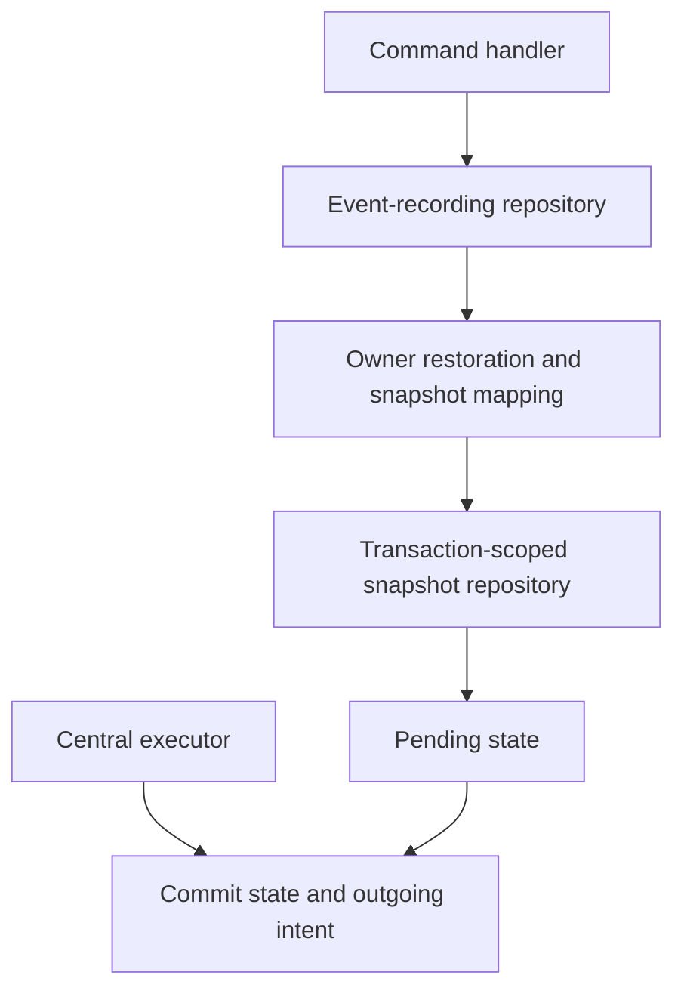

# Write repositories

A named write repository loads and saves the authoritative aggregate for one
command invocation. The handler depends on its application port. The persistence
adaptor restores domain state and stages the snapshot in the active transaction.

## Creation recipe

1. Define `<Aggregate>WriteRepository` in the owner's application ports with load and save capabilities for that root.
2. Implement snapshot restoration and validation in owner persistence. See [aggregate hydration](aggregate-hydration.md).
3. Implement the concrete mapped repository: its load path restores a snapshot plus revision; save captures the aggregate's snapshot. Aggregate children remain inside this repository boundary.
4. Define the owner private-fact mapper and configure it on the aggregate transaction. The recording repository stages private facts through `DomainEventBusPort` when saving.
5. Bind the transaction once per aggregate in DI. Its registration helper supplies a fresh repository to each named command handler.
6. Call load, aggregate behaviour and save inside that handler. The executor owns flush, expected-version checks, receipts and commit.
7. Select any realtime output explicitly through `RealtimeBusPort`. Test that saving without this call produces no browser publication, and that encoding failure rolls back explicit publication and state together.

Follow the [end-to-end recipe](../end-to-end-recipe.md) to connect this step to the complete workflow.

## Owner-specific implementations

Each implementation binds the shared mapped repository to the owner's restoration
and snapshot operations. The shared helper knows mechanics; the context selects
the domain model and its mappings.

### Go

Source: [order_write_repository.go](../../../services/storefront/contexts/ordering/adaptors/persistence/postgres/order_write_repository.go).

```go source="../../../services/storefront/contexts/ordering/adaptors/persistence/postgres/order_write_repository.go"
package postgres

import (
	store "github.com/pharos-ai-factory/ddd-hexagonal-cqrs-es-eda-microservices-multilingual/services/storefront/adaptors/persistence/postgres"
	"github.com/pharos-ai-factory/ddd-hexagonal-cqrs-es-eda-microservices-multilingual/services/storefront/contexts/ordering/application/ports"
	d "github.com/pharos-ai-factory/ddd-hexagonal-cqrs-es-eda-microservices-multilingual/services/storefront/contexts/ordering/domain"
	a "github.com/pharos-ai-factory/ddd-hexagonal-cqrs-es-eda-microservices-multilingual/services/storefront/foundation/application"
)

// NewOrderWriteRepository maps the scoped PostgreSQL snapshot repository to owner aggregates.
func NewOrderWriteRepository(source a.WriteRepository[d.OrderState]) ports.OrderWriteRepository {
	return store.MappedWriteRepository[d.OrderState, *d.Order]{Source: source, Restore: d.Restore, Snapshot: (*d.Order).Snapshot}
}
```

### Python

Source: [ticket_write_repository.py](../../../services/operations/src/operations/contexts/preparation/adaptors/persistence/ticket_write_repository.py).

```python source="../../../services/operations/src/operations/contexts/preparation/adaptors/persistence/ticket_write_repository.py"
"""PostgreSQL aggregate restoration and persistence owned by Preparation."""

from operations.adaptors.persistence.mapped_write_repository import MappedWriteRepository
from operations.foundation.write_repository import WriteRepository
from operations.contexts.preparation.domain.preparation_ticket import PreparationTicket, TicketSnapshot


class PostgresTicketWriteRepository(MappedWriteRepository[TicketSnapshot, PreparationTicket]):
    """Load authoritative aggregates and stage their snapshots in the active transaction."""

    def __init__(self, source: WriteRepository[TicketSnapshot]) -> None:
        super().__init__(source, PreparationTicket.restore, PreparationTicket.snapshot)
```

### TypeScript

Source: [reward-write-repository.ts](../../../services/engagement/src/contexts/loyalty/adaptors/persistence/reward-write-repository.ts).

```ts source="../../../services/engagement/src/contexts/loyalty/adaptors/persistence/reward-write-repository.ts"
import type { WriteRepository } from '../../../../foundation/write-repository.js';

import { MappedWriteRepository } from '../../../../adaptors/persistence/mapped-write-repository.js';
import { Reward, type RewardState } from '../../domain/reward.js';

/** Restore authoritative aggregates and stage snapshots in the active PostgreSQL transaction. */
export class PostgresRewardWriteRepository extends MappedWriteRepository<RewardState, Reward> {
  constructor(source: WriteRepository<RewardState>) {
    super(
      source,
      (state) => new Reward(state),
      (aggregate) => aggregate.snapshot(),
    );
  }
}
```

## The layered persistence path

The command receives a repository wrapped with event recording. Calling `Get` or
`get` goes through the owner mapping to the transaction-scoped snapshot repository.
Calling `Save` or `save` collects the selected private facts and stages the saved
snapshot. The central transaction flushes that state and its outgoing intent.



The scope enforces one target and closes after the invocation. A child entity has
no independent write repository. Query handlers instead use
[read repositories](read-repositories.md), which return application views.

## Verification

Plain handler tests can establish that the handler calls the expected behaviour
and stages the result. Real PostgreSQL tests establish rollback, expected-version
conflicts, repository lifetime and atomic state/outbox/reply persistence.

## Related concepts

[Ports](ports.md) · [Aggregate hydration](aggregate-hydration.md) · [Command handlers](command-handlers.md) · [Transactions](transactions.md)

[Concept catalogue](index.md) · [Learning path](../index.md)
