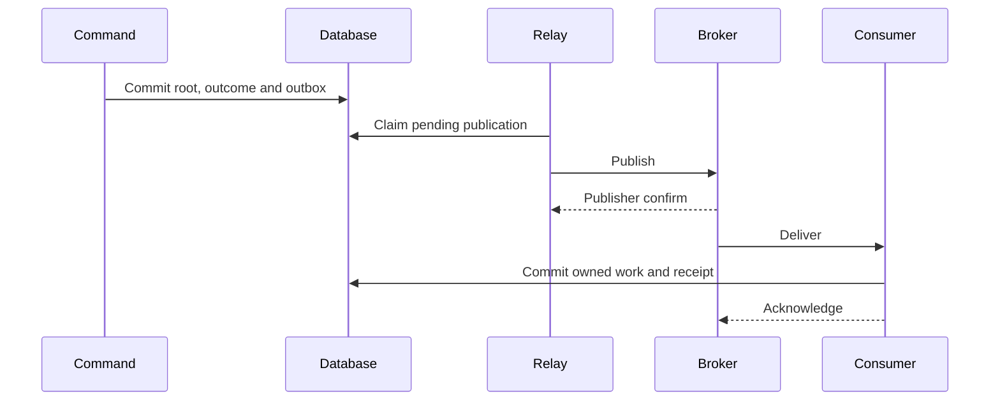

# Consistency and reliable delivery

Business consistency starts with identifying what must be true together. The
café protects an aggregate transition in one database transaction. Work involving
other aggregates proceeds through explicit pending states and durable messages.

## Local transactions and optimistic concurrency

A transaction makes the chosen local changes commit together or roll back. Here,
that boundary includes aggregate state, receipts, the command outcome and outgoing
private facts and explicitly selected realtime intent. API commands also persist
exact reply bytes. A declared event subscriber can publish a browser update later,
committing its receiving receipt and exact browser bytes in a separate transaction.
The [realtime recipe](concepts/realtime-events.md) explains both choices.

**Optimistic concurrency** checks that the stored version still matches the
version on which a decision was based. If two operators edit Order revision 7,
only a compatible first update can advance it. The other attempt must resolve
the stale version instead of silently overwriting the first change.

A lock protects a particular execution interval. A version check protects the
relationship between a caller's observed state and the attempted write. Their
roles should be stated explicitly when designing concurrent operations.

## The dual-write problem and outbox

Saving an Order and then publishing its event creates a failure window: the
process can stop after the save. Publishing first creates the opposite window,
where a consumer sees a fact whose database change later rolls back.

The **transactional outbox** records publication intent in the same database
transaction as the local change. A relay delivers committed intent afterwards.
It makes the intent atomic with the state change. It still requires recovery and
duplicate handling. See the
[transactional outbox pattern](https://microservices.io/patterns/data/transactional-outbox.html).

The database participant represents each owner's local database at the relevant
step. The consumer commits its own transaction. The broker participates in neither
database transaction. A publisher confirm establishes broker acceptance; a
consumer acknowledgement establishes that delivery's processing boundary.

## Duplicate delivery and receipts

After a publish succeeds, the relay can lose the confirmation or fail before
recording completion. Retrying may deliver the same message again. A consumer
uses a durable receipt to recognise work already accepted. The receipt commits
with its owned work, so an acknowledged delivery has durable evidence. This is
the [idempotent consumer pattern](https://microservices.io/patterns/communication-style/idempotent-consumer.html).

The café also deduplicates business occurrences. Two different event IDs describing
the same order collection must earn only one loyalty credit. Message identity
and the business identity of a collection address different duplicate cases.

An identical command retry retains its identity and input, including the original
expected version. Its recorded outcome can be recovered even if later work has
advanced the aggregate. A fresh attempt has a fresh command identity. Reusing an
identity with changed material input is a conflict.

## Failure handling and ordering

| Situation                                | Required response in this reference                                        |
| ---------------------------------------- | -------------------------------------------------------------------------- |
| Process stops before commit              | Retry without treating partial work as accepted                            |
| Commit succeeds but reply is lost        | Retry the identical command to recover its stored outcome                  |
| Relay loses confirmation                 | Republish with stable identity; consumer deduplication protects the effect |
| Consumer fails before commit             | Leave the delivery available for retry                                     |
| Event reaction commits a command         | ACK the event; the command consumer owns subsequent execution              |
| Message repeatedly fails                 | Use bounded retry, dead-letter evidence and explicit replay                |
| Old relay resumes after losing its lease | A fencing token prevents it completing the newer worker's claim            |

Retries, multiple consumers and independent queues can change arrival order.
Model sequence requirements explicitly. The browser rejects stale root revisions;
a business workflow may need different rules, such as prerequisites or retained
pending work. Timestamps alone do not establish a reliable global order.

## Eventual consistency and external effects

**Eventual consistency** permits related representations or workflows to converge
after separate commits. Convergence depends on delivery, recovery and a usable
business policy. A reward grant can remain pending while issuance is unavailable;
diagnostics and recovery must make that condition visible and actionable.

An email provider is outside the database transaction. If it accepts a request
and the response is lost, a retry needs a stable provider idempotency identity.
The café's provider simulator and real infrastructure tests exercise this failure
window. A database receipt alone cannot control a remote provider's effects.

These mechanisms support a bounded claim: particular state changes and effects
are protected by particular identities and transactions. Assess any “exactly
once” claim against that concrete boundary.

**Try it:** stop the relay mentally after every arrow in the sequence diagram.
For each stop, name the durable evidence and the safe next action. Compare your
answers with [the transaction rules](../../ARCHITECTURE.md#transaction-rule).

Next: [Event sourcing](event-sourcing.md).
