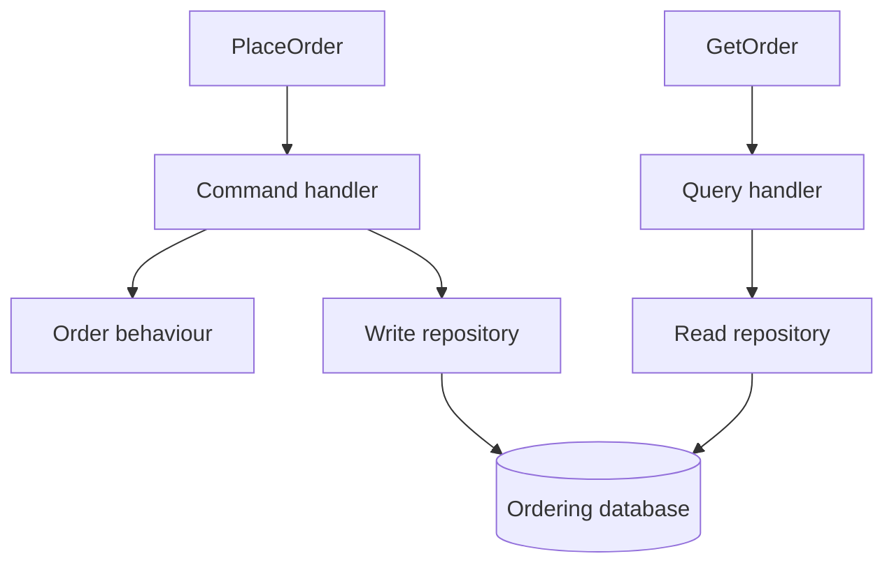

# CQRS: decisions and views

**Command Query Responsibility Segregation** separates the model used to change
state from the model used to read it. A command expresses intent; a query asks for
information. Separate models can share one database and one process. As
[Fowler's CQRS discussion](https://martinfowler.com/bliki/CQRS.html) explains, the
benefit depends on whether the two responsibilities need different models.

## Commands express business tasks

`PlaceOrder` requests a transition with consequences. It can succeed, be rejected
by a rule or encounter an infrastructure failure. A generic `UpdateOrder` request
with arbitrary fields would give callers more responsibility for understanding
which changes are legal together.

The café's command handler loads the aggregate, invokes its behaviour and saves
it. A caller-driven command carries a stable command identity and expected
revision. The central executor handles retries, concurrency and its recorded
outcome.

Commands here return an acknowledgement or business result. CQRS separates the
models and responsibilities; it does not require every command endpoint to have
an empty response. Method-level **command-query separation**, which typically
distinguishes changing operations from value-returning queries, is a related
principle with a different scope.

## Queries return useful representations

`GetOrder` returns an application-owned view with the fields its caller needs.
It uses a named read repository. The query avoids acquiring aggregate mutation
capabilities and preserves the resource revision and missing-resource behaviour.

This diagram represents the reference's shared storage arrangement within one
context. The query and command responsibilities remain separate even though they
read and write the same database.

Compare [PlaceOrder](../../services/storefront/contexts/ordering/application/commands/place_order.go)
with [GetOrder](../../services/storefront/contexts/ordering/application/queries/get_order.go).
The persistence read adaptor validates stored authority and maps the result into
the application's read model.

## Read models and projections

A **read model** is shaped for a question or presentation. A **projection** builds
or updates a representation from source information, often by consuming events.
A directly selected read view and an asynchronously maintained projection are
both useful designs, with different freshness guarantees.

Ordering owns a projection of published menu information. It can decide whether
an order uses known published terms without reading Menu's private database.
The [menu projection handler](../../services/storefront/contexts/ordering/application/projections/menu_published.go)
maintains that local evidence.

If the projection has not arrived, the command's recorded rejection can remain
`menu_pending`. Once the projection arrives, an identical retry recovers the same
recorded outcome; a new business attempt uses a new command identity. The
[projection recovery scenarios](../../specifications/ordering/projection-recovery.feature)
make that distinction executable.

## Freshness and user experience

Separating storage or updating a view asynchronously introduces a visible delay.
A successful command confirms its own committed transition. Other workflow
steps and projections may still be pending.

The browser receives owner revisions through Centrifugo and reconciles through
queries. A later revision wins over a delayed older response. The
[browser contract](../../CLIENT-SUBSCRIPTIONS.md) specifies recovery and uncertain
command attempts; CQRS alone does not define those behaviours.

## When separation pays for itself

CQRS can clarify complex write rules while keeping read queries simple. It also
allows distinct read and write optimisations. Costs include more representations,
mapping and, where used, projection recovery and lag monitoring. A straightforward
CRUD feature may work well with one model.

**Try it:** design the fields needed by a preparation-board query. Identify which
fields belong in its view and which operations must still go through a command.

Next: [Event-driven architecture](event-driven-architecture.md).
