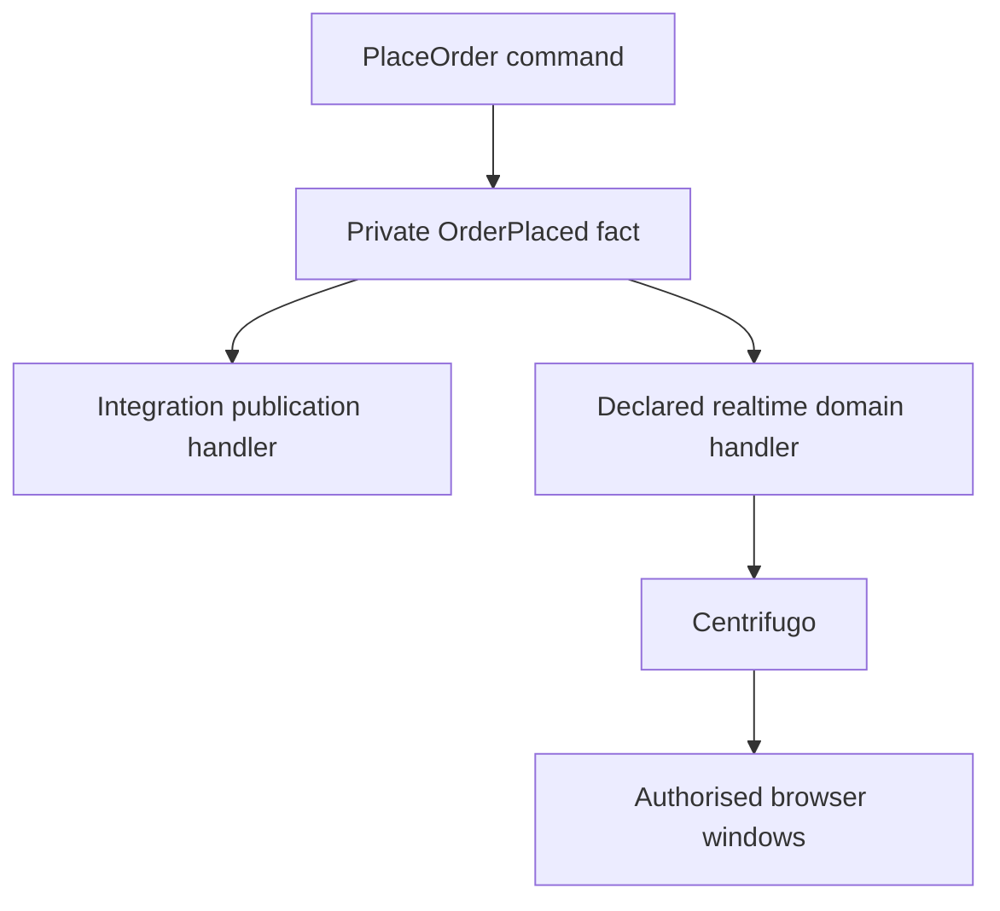
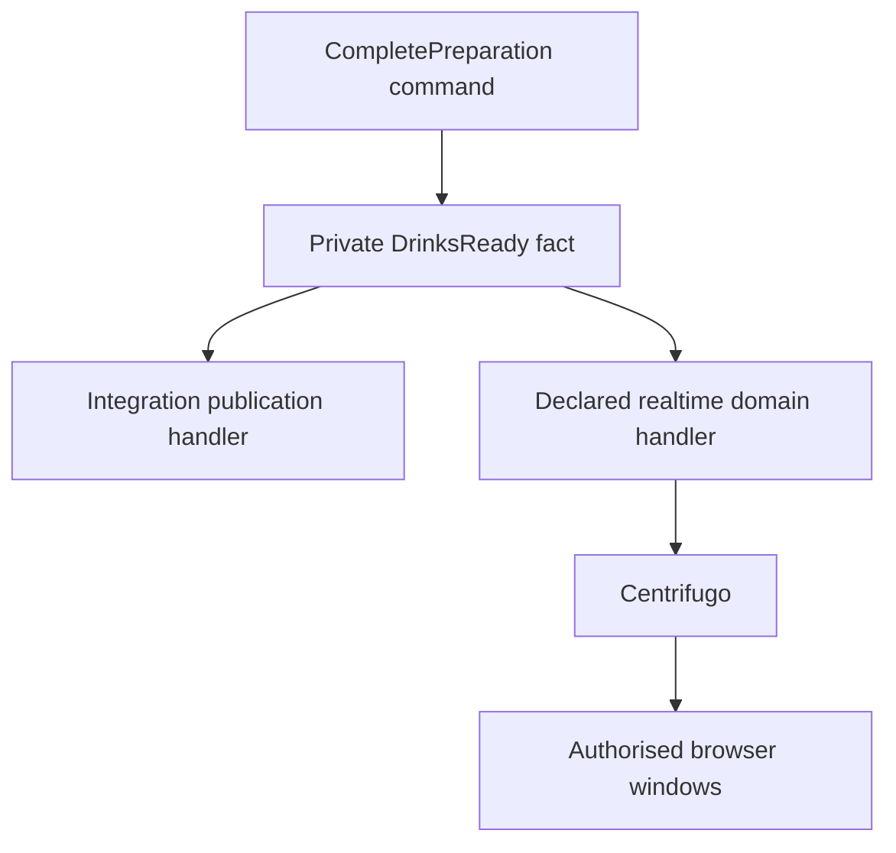
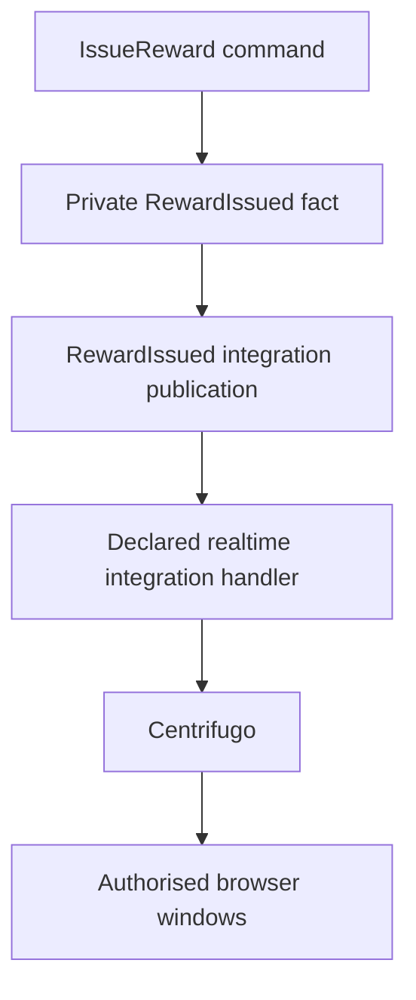

# Build a command-to-browser workflow

Follow these steps in order. Each step links to the concept recipe and actual
implementation. The examples preserve the current café invariants and use the
same transaction/delivery infrastructure in Go, Python and TypeScript.

## 1. Name the owner, invariant and allowed pending state

Run `pnpm context <context>` and read its README before adding a use case.

| Language   | Command and aggregate                       | Immediate invariant                          | Allowed pending state                                                     |
| ---------- | ------------------------------------------- | -------------------------------------------- | ------------------------------------------------------------------------- |
| Go         | `PlaceOrder` → `Order`                      | A draft contains one to five drinks          | Placed order awaiting integration publication and its browser subscriber  |
| Python     | `CompletePreparation` → `PreparationTicket` | Only a preparing ticket becomes ready        | Ready ticket awaiting Collection and its browser subscriber               |
| TypeScript | `IssueReward` → `Reward`                    | One reward per earned grant with fixed terms | Issued reward awaiting integration publication and its browser subscriber |

The TypeScript example starts from a **private durable command** triggered by
`RewardEarned`. `RedeemReward` is the separate public command example; redemption
explicitly publishes its snapshot and can publish a rejection, and currently
records no delivered domain fact.

## 2. Define the command contract and routing identity

For a new API command, edit the owner's published command payload and request
oneof, then run `pnpm generate:contracts`. For an internal reaction, edit the
owner's private command envelope with `visibility: PRIVATE`. Both paths generate
the plain command payload; the owner codec retains semantic and receipt checks. The complete
[command recipe](concepts/commands.md) explains generated names, imports, wire
parsers and registration step by step.

| Language   | Wire source                                                                                                                                                                                      | Owner input mapper                                                                                                     |
| ---------- | ------------------------------------------------------------------------------------------------------------------------------------------------------------------------------------------------ | ---------------------------------------------------------------------------------------------------------------------- |
| Go         | [Ordering commands](../../contracts/ordering/messaging/commands/v1/ordering_commands.proto) and [request envelope](../../contracts/ordering/messaging/v1/ordering_requests.proto)                | [PlaceOrder mapper](../../services/storefront/contexts/ordering/adaptors/messaging/request_payloads_generated.go)      |
| Python     | [Preparation commands](../../contracts/preparation/messaging/commands/v1/preparation_commands.proto) and [request envelope](../../contracts/preparation/messaging/v1/preparation_requests.proto) | [complete mapper](../../services/operations/src/operations/contexts/preparation/adaptors/messaging/ticket_requests.py) |
| TypeScript | [private command envelope](../../services/engagement/src/contexts/loyalty/adaptors/messaging/internal_commands.proto)                                                                            | [IssueReward codec](../../services/engagement/src/contexts/loyalty/adaptors/messaging/issue-reward-codec.ts)           |

Keep command ID, target, expected revision and correlation in the execution
envelope. An identical retry keeps its identity and material input. A new business
attempt gets a new command ID.

## 3. Import the generated command and write its handler

Declare the command fields once in Protobuf with owner and visibility, then run
`pnpm generate:contracts`. Import the generated plain type into its handler under
`application/commands/<action>`.
Inject its named write repository. The full source files are
[PlaceOrder](../../services/storefront/contexts/ordering/application/commands/place_order.go),
[CompletePreparation](../../services/operations/src/operations/contexts/preparation/application/commands/complete_preparation.py)
and [IssueReward](../../services/engagement/src/contexts/loyalty/application/commands/issue-reward.ts).
Follow the [command-handler recipe](concepts/command-handlers.md).

These handlers deliberately delegate their browser update to an event subscriber.
A command that publishes directly receives `RealtimeBusPort` as a separate
constructor port. Its registration factory receives the invocation's repository
and realtime bus.

## 4. Implement load, hydration, mutation and save

Define `<Aggregate>WriteRepository` in the application and its concrete mapping in
owner persistence. `get` loads a snapshot plus revision and calls the owner restore
function. Restoration validates stored authority and starts with no new facts.
The command checks absence, invokes aggregate behaviour, and calls `save`.
Creation commands construct the aggregate after checking the target is absent.

| Language   | Write adaptor                                                                                                                            | Restoration                                                                                                             |
| ---------- | ---------------------------------------------------------------------------------------------------------------------------------------- | ----------------------------------------------------------------------------------------------------------------------- |
| Go         | [Order write repository](../../services/storefront/contexts/ordering/adaptors/persistence/postgres/order_write_repository.go)            | [Order.Restore](../../services/storefront/contexts/ordering/domain/order.go)                                            |
| Python     | [Ticket write repository](../../services/operations/src/operations/contexts/preparation/adaptors/persistence/ticket_write_repository.py) | [PreparationTicket.restore](../../services/operations/src/operations/contexts/preparation/domain/preparation_ticket.py) |
| TypeScript | [Reward write repository](../../services/engagement/src/contexts/loyalty/adaptors/persistence/reward-write-repository.ts)                | [Reward constructor](../../services/engagement/src/contexts/loyalty/domain/reward.ts)                                   |

The [write repository](concepts/write-repositories.md), [hydration](concepts/aggregate-hydration.md)
and [aggregate](concepts/aggregates.md) recipes supply the implementation sequence.

## 5. Record the private fact alongside the aggregate change

Define a plain domain event and append it only after its invariant succeeds.
The examples record `OrderPlacedDomainEvent`, `DrinksReadyDomainEvent` and
`RewardIssuedDomainEvent`. An aggregate has no bus or transport dependency.

To deliver a new private fact, complete all of these owner files:

1. Domain fact and aggregate behaviour.
2. `adaptors/messaging/private_messages.proto`: compatible private payload/envelope.
3. `private_messages.json`: stable name, owner, kind and private visibility.
4. Handwritten private codec and semantic validation.
5. Aggregate-to-private-publication mapper.
6. Historical encoded-byte fixture and codec tests.

The [domain-event recipe](concepts/domain-events.md) links each concrete source and
shows all three language mappings. Run `pnpm generate:contracts` after schema or
catalogue changes. The write adaptor uses `DomainEventBusPort` to stage selected
private facts inside the root transaction.

## 6. Bind command execution once per aggregate

Configure the owner transaction, restore function, write repository factory and
private-fact mapper. Register the generated command name or private codec with its
input parser and plain handler factory. The shared helper supplies execution,
deduplication, expected-version checks and the invocation-scoped realtime bus.

See [Go registration](../../services/storefront/apps/storefront/di/ordering_requests.go),
[Python composition](../../services/operations/src/operations/apps/composition/preparation.py)
and [TypeScript composition](../../services/engagement/src/apps/composition/loyalty.ts).
Resolve repositories, handlers and subscribers before starting workers.

The executor assembles the schema-generated command outcome and commits the root,
outcome, receipts, exact reply bytes and selected
outgoing intent. A technical failure rolls back; an expected rejection records
its outcome. Read the [transaction recipe](concepts/transactions.md).

## 7. Define the integration contract and publication handler

Add the published payload to `contracts/<context>/messaging/integration_events/v1/`
with its owner event annotation and boundary constraints. Generate the plain DTO,
codec and typed publication factory. Implement a named domain-event handler that
maps the private fact into that DTO and calls `IntegrationEventBusPort`.

| Language   | Published schema                                                                                                                   | Mapping handler                                                                                                                             |
| ---------- | ---------------------------------------------------------------------------------------------------------------------------------- | ------------------------------------------------------------------------------------------------------------------------------------------- |
| Go         | [Ordering integration events](../../contracts/ordering/messaging/integration_events/v1/ordering_integration_events.proto)          | [publish_order_placed.go](../../services/storefront/contexts/ordering/application/eventhandlers/publish_order_placed.go)                    |
| Python     | [Preparation integration events](../../contracts/preparation/messaging/integration_events/v1/preparation_integration_events.proto) | [publish_drinks_ready.py](../../services/operations/src/operations/contexts/preparation/application/event_handlers/publish_drinks_ready.py) |
| TypeScript | [Loyalty integration events](../../contracts/loyalty/messaging/integration_events/v1/loyalty_integration_events.proto)             | [publish-reward-issued.ts](../../services/engagement/src/contexts/loyalty/application/event-handlers/publish-reward-issued.ts)              |

Declare the private subscription's `publication` in `subscriptions.json`. Bind its
concrete publication outbox, handler and generated subscription ID in composition.
The receiving receipt, exact integration bytes and dispatch commit before ACK.
Keep the private fact's original revision/time and its event ID as causation.
See [integration events](concepts/integration-events.md) and
[domain event handlers](concepts/domain-event-handlers.md).

## 8. Declare any aggregate-changing integration reaction

A consumer that changes business state defines its private command schema and imports
the generated command into its handler. It also supplies its
private command codec and `command` subscription entry. Its integration handler
maps the public DTO and calls `CommandBusPort.enqueue`. Acceptance commits exact
command bytes and receiving evidence; a separate command worker executes later.

Python's [OrderPlaced reaction](../../services/operations/src/operations/contexts/preparation/application/event_handlers/order_placed.py)
enqueues `AcceptOrder`. TypeScript's [OrderCollected reaction](../../services/engagement/src/contexts/loyalty/application/event-handlers/order-collected.ts)
enqueues `CreditCollection`. The [durable-command recipe](concepts/durable-commands.md)
explains the paired consumer registration and retry boundaries.

Go's [OrderCollected reaction](../../services/storefront/contexts/ordering/application/eventhandlers/order_collected.go)
enqueues `RecordCollection`, targeting `event.OrderID`. Follow the
[Go creation steps](concepts/durable-commands.md#go-record-collection-on-the-order)
for the private Protobuf oneof, codec, manifest, generated identifiers, bus provider
and `registration.Subscribe` call. The handler restores the Order, requires a
placed order and matching customer, records collection once, saves and explicitly
publishes `collectionRecorded: true` through `RealtimeBusPort`. Placement status
remains `placed`; Collection continues to own physical handover. A collected
Pickup awaiting this command is an allowed pending state.

The command publication commits with the changed root and receipts. It has no
automatic integration-to-realtime mapping. Duplicate source delivery recovers the
recorded outcome; a new event identity for an already recorded collection leaves
the Order revision and browser outbox unchanged.

## 9. Explicitly select the browser publication

Use the [realtime recipe](concepts/realtime-events.md) to choose an application,
domain-event or integration-event producer. The running chains are:

### Go: an explicitly declared domain-event subscriber



### Python: an explicitly declared domain-event subscriber



### TypeScript: an explicitly declared integration-event subscriber



Add a separate `realtime` subscription entry and bind its bus/handler. A delayed
subscriber reads the owner view and publishes that view's actual revision. Other
commands explicitly publish their snapshot within their own transaction. Neither
saving state nor publishing integration events automatically forwards to realtime.

## 10. Expose queries and connect the frontend

Implement the [complete query recipe](concepts/queries.md): query schema and reply,
generated input/response DTOs and encoders, resource aliases, read repository, handler, typed binding,
DI registration, OpenAPI operation and API translation. Call the generated browser
operation client. The frontend attaches server-authorised subscriptions before its
initial query and reconciles again after an unrecoverable history gap.

The [browser decoder](../../services/web/src/adaptors/realtime/message-codec.ts)
validates owner, target, channel, payload identity and revision. `RealtimeProvider`
owns the transport while feature hooks register typed `useRealtimeMessage` handlers.
The café state hook applies state messages and displays operation rejections
separately. Keep each window's revision guard,
uncertain command recovery and session revocation behaviour.

## 11. Verify the recipe as a complete use case

Run the relevant focused lane, then the shared checks:

```sh
pnpm test:focused storefront --context ordering
pnpm test:focused operations --context preparation
pnpm test:focused engagement --context loyalty
pnpm check --changed
pnpm verify
pnpm test:integration
```

Test the invariant and repository call order, DI resolution and routing, private
codec compatibility, subscriber declaration, atomic outbox/receipt commits,
redelivery, rejected attempts, realtime rollback, stale revisions and browser
recovery. An event-driven browser update may remain pending after command commit;
assert eventual arrival instead of assuming integration and realtime ordering.
Record actual evidence in `docs/verification.md`.
