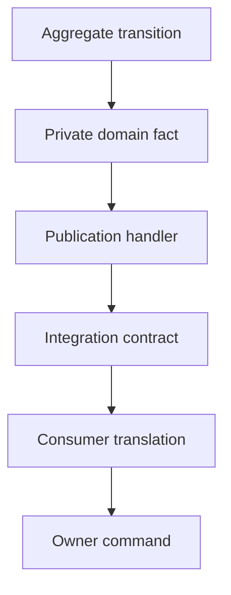

# Event-driven architecture: facts and reactions

An event-driven system connects parts of an application through facts that have
occurred. A publisher records a fact; subscribers decide what it means for their
own responsibilities. An event describes an outcome such as `OrderPlaced`.
A command requests work such as `AcceptOrder`.

## Messages and meaning

A **message** is a delivery unit. Its business meaning may be a command, event,
query or reply. Using RabbitMQ establishes a transport choice; the meaning comes
from the contract and the owner that interprets it.

| Kind    | Meaning                               | Café example              |
| ------- | ------------------------------------- | ------------------------- |
| Command | Request for an owner to decide or act | PlaceOrder                |
| Event   | Fact that has already occurred        | OrderPlaced               |
| Query   | Request for information               | GetOrder                  |
| Reply   | Outcome of a request                  | Recorded placement result |

An event subscriber may reject a subsequent command without invalidating the
original event. An order can have been placed even while Preparation's reaction
is unavailable or awaiting recovery.

## Domain facts and integration contracts

A **domain event** expresses a fact in the owner's model. An **integration event**
is a published contract intended for other contexts. Their data may overlap,
but their compatibility obligations differ.

In this reference, aggregates queue plain domain facts. Saving stages private
delivery intent. A dedicated publication handler receives the private fact,
maps it into a generated integration DTO and commits publication intent with its
receipt. That subscriber preserves the original occurrence time and revision.

The publication handler, integration consumer and owner command run through
separate durable deliveries. Recording a fact and mapping a DTO are local steps
within those operations. Private domain facts remain context-private even when
transported through RabbitMQ.

The [Preparation reaction](../../services/operations/src/operations/contexts/preparation/application/event_handlers/order_placed.py)
translates a published order into an owner command. The later command consumer
creates or changes the preparation aggregate. The extra command queue is an
explicit reference convention, described in
[decision 0011](../decisions/0011-durable-commands-before-aggregate-mutations.md).

## Different uses of events

Event notification announces that something changed, often requiring a later
query for details. Event-carried state transfer includes data the consumer needs
to maintain a local representation. Event sourcing makes an event stream the
authoritative history from which state is reconstructed. These choices have
different purposes; see Fowler's
[event-driven terminology](https://martinfowler.com/articles/201701-event-driven.html).

The café's published menu carries immutable offer terms so Ordering can retain
its own usable representation. The repository still stores current aggregate
state as its persistence authority.

## Contract design

A useful event contract identifies the business occurrence and supplies the
facts consumers are authorised to use. Prefer meanings stable across internal
refactors. Serialising a private domain object directly couples consumers to its
implementation and may expose unrelated data.

The café declares published interfaces under [contracts](../../contracts/README.md).
Protobuf annotations define event identities and constraints; generated DTOs and
codecs enforce the declared boundary. Consumers declare their own subscriptions.
Changing a class name does not allocate a new historical wire identity.

Distinguish identifiers: an event ID identifies a particular message fact;
correlation groups a workflow; causation identifies the triggering message;
aggregate identity and revision identify the business state involved. A shared
correlation ID cannot safely deduplicate all work in a workflow.

## Costs and operational evidence

Subscribers can progress independently, but a successful publication leaves their
completion unknown. Operators need to inspect pending work, failures and replay
state. A queue with no messages can coexist with failed or unfinished business
work elsewhere.

**Try it:** follow an OrderPlaced integration event into Preparation. Identify the
incoming contract, its translation, the durable command and the aggregate that
eventually changes. State which step can safely acknowledge each delivery.

Next: [Consistency and reliable delivery](consistency-and-delivery.md).
