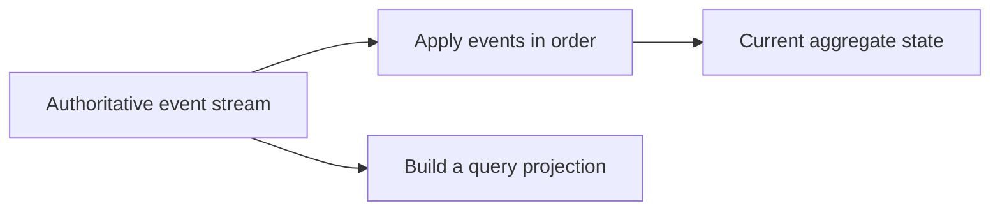

# Event sourcing: choosing the source of truth

**Event sourcing** stores an aggregate's authoritative changes as an ordered
event stream. Reconstructing state applies those events in sequence. Fowler's
[Event Sourcing](https://martinfowler.com/eaaDev/EventSourcing.html) introduces
this persistence approach and its implications for replay.

## A hypothetical café example

An event-sourced Order might be reconstructed from this illustrative stream:

```text
1. OrderOpened
2. LineAdded(quantity = 2)
3. LineQuantityChanged(quantity = 3)
4. OrderPlaced
```

Folding the stream produces a placed order with three drinks. These are teaching
examples of possible event names, not this repository's event-sourced storage
format. Appending new events would require an expected stream revision to protect
concurrent writers.



State reconstruction should reproduce recorded decisions deterministically.
It should not send another email or ask today's price service to reinterpret a
historical purchase. External effects belong to controlled delivery workflows.

## Snapshots and projections

An event-sourcing **snapshot** is an optimisation: state cached at a known stream
revision, followed by application of later events. The authoritative stream must
remain sufficient for the promised reconstruction behaviour.

A **projection** is a derived view answering a question. It may be rebuilt from
an available event history when that history contains sufficient information.
Retention, event evolution and access to required historical facts determine
whether a rebuild is actually possible.

The word “snapshot” also appears in current-state persistence. There it can mean
the saved authoritative aggregate state. The same word describes different
responsibilities; identify the actual source of truth before reasoning about replay.

## What this repository implements

| Mechanism             | Role here                                     |
| --------------------- | --------------------------------------------- |
| Saved aggregate state | Current business authority                    |
| Domain events         | Private facts selected for delivery           |
| Integration events    | Published contracts for other contexts        |
| Outbox                | Durable dispatch intent and retry bookkeeping |
| Receipts              | Evidence of accepted or executed work         |
| Dead-letter replay    | Another controlled delivery attempt           |

The repository uses **current-state persistence**. Loading an aggregate restores
its saved state; it does not fold its complete historical event stream. Its outbox
is designed for delivery and makes no promise to retain a complete reconstruction
history. The repository name retains `es` from its lineage; the
[architecture](../../ARCHITECTURE.md) defines the current choice.

## Benefits, costs and adoption

Event sourcing can support detailed historical reasoning and alternative derived
views when retained events capture the required facts. It also makes event
evolution, deterministic reconstruction, correction policies and retention part
of the core storage design. Sensitive data requires an explicit lifecycle policy
when stored in a durable history.

A decision to adopt it here would need a documented owner scope, event schema,
append/concurrency rules, restoration algorithm, migration plan and recovery
tests. Adding another subscriber or saving messages for diagnostics would leave
the existing persistence model unchanged.

**Try it:** compare replaying a dead-lettered RewardIssued delivery with rebuilding
a Reward aggregate from a hypothetical event stream. Identify what each operation
reads, what it may change and how duplicate external effects are prevented.

Next: [Modelling and service boundaries](modelling-and-boundaries.md).
