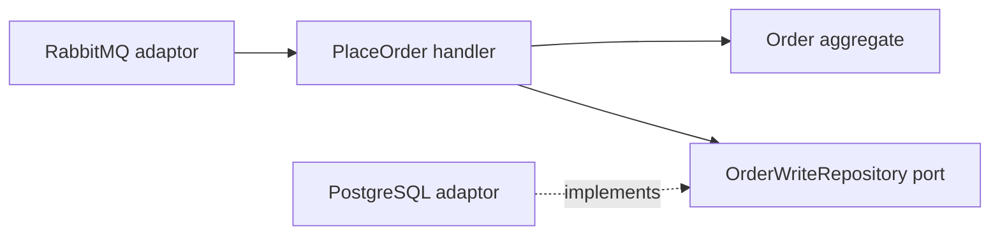

# Hexagonal architecture: ports and adaptors

**Hexagonal architecture** and **ports and adaptors** name the same architectural
pattern. The application exposes meaningful interactions and expresses its needs
through ports. Adaptors connect those interactions to concrete technologies.
The hexagon is a visual aid; it does not prescribe six components. See
[Alistair Cockburn's original article](https://alistair.cockburn.us/hexagonal-architecture).

## Ports describe capabilities

A **port** is a boundary expressed in terms the application understands. A command
handler offers an operation such as placing an order. An application repository
port expresses the ability to load and save an Order.

An **adaptor** translates between that boundary and a particular outside system.
A PostgreSQL repository implements persistence. A RabbitMQ request adaptor
decodes a transport message and calls the appropriate application operation.

| Role                       | Direction of interaction                    | Example                              |
| -------------------------- | ------------------------------------------- | ------------------------------------ |
| Driving or inbound adaptor | Initiates an application operation          | Ordering's RabbitMQ command consumer |
| Inbound port               | Offers an application capability            | The PlaceOrder handler contract      |
| Outbound port              | Declares a capability the application needs | `OrderWriteRepository`               |
| Driven or outbound adaptor | Implements that capability                  | PostgreSQL Order persistence         |

A port can be an interface, protocol, function or ordinary public method. Create
the abstraction around a meaningful capability. Its usefulness comes from the
boundary it protects.

## Dependency direction and runtime calls

Source dependencies point towards application and domain policy. An infrastructure
adaptor can depend on an application port; an aggregate remains independent of
the database driver or transport library.

The handler calls the configured PostgreSQL object at runtime through the port.
The handler's source still depends on the port contract. This distinction between
runtime call flow and source dependency direction explains **dependency inversion**.

**Dependency injection** supplies the collaborator to the handler. The composition
root selects and connects concrete implementations. Fowler's
[dependency injection article](https://martinfowler.com/articles/injection.html)
explains this separation of configuration from use. A container automates wiring;
plain constructor injection can implement the same principle.

## Follow PlaceOrder

The café has an additional API process at its outer boundary:

1. The Go API translates authenticated HTTP input into a published Protobuf command.
2. Ordering's RabbitMQ adaptor maps that message into application input.
3. [PlaceOrderCommandHandler](../../services/storefront/contexts/ordering/application/commands/place_order.go)
   loads the Order through its named write repository and invokes `Place`.
4. The aggregate accepts or rejects the business transition.
5. The repository stages the changed state; the executor commits the invocation.

The handler receives neither an AMQP delivery nor an SQL transaction. The API's
translation work provides access to the use case; the owning domain decides
whether placement is permitted.

## Layers and neighbouring approaches

**Domain** code expresses business meaning and rules. **Application** code
coordinates use cases. **Adaptors** decode external data, restore stored values
and deliver effects. **Composition** constructs the dependency graph.

Layered, onion and clean architectures also address separation and dependency
direction. Hexagonal architecture emphasises the application's interactions
through ports. These approaches can lead to similar code boundaries; copying a
diagram's folder names alone does not establish them.

This repository uses Fx, Dependency Injector and Awilix in the respective services'
`apps/` composition roots. Plain handlers remain independent of those frameworks.
See [decision 0010](../decisions/0010-dependency-injection-frameworks.md) and the
[adaptor map](../adaptor-layout.md).

## Benefits and costs

An isolated domain rule is cheap to test. A new transport can invoke the same use
case, and persistence details can change behind a stable port. The trade-off is
additional mapping and wiring. Database semantics still matter: replacing a
PostgreSQL adaptor with a fake cannot establish transaction or concurrency behaviour.

**Try it:** locate the Order write port, its PostgreSQL implementation and the Fx
registration. Explain which file would change if a new caller needed the same
PlaceOrder operation and which business rules would remain in the aggregate.

Next: [CQRS](cqrs.md).
