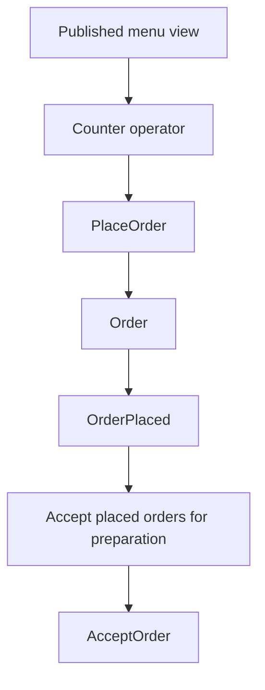

# From business modelling to service boundaries

Good boundaries come from understanding decisions, language and change. Starting
with one service per noun can separate state that must change together while
coupling unrelated lifecycles through network calls.

## Discover the process with EventStorming

**EventStorming** is a collaborative modelling approach associated with Alberto
Brandolini. Participants explore business events and their relationships,
surfacing disagreements and unanswered questions. See the
[EventStorming introduction](https://www.eventstorming.com/).

For a café exercise, put MenuPublished, OrderPlaced, DrinksReady and OrderCollected
on a timeline. Add the actors and commands that lead to them. Then identify the
information each actor needs and the policies that request subsequent work.

This diagram models business relationships. The implementation places durable
delivery boundaries between the event and the next aggregate-changing command.

Useful unresolved questions include whether cancellation is permitted after
preparation starts and when a reward's validity begins. The current café does
not implement cancellation. Treat such a question as a modelling extension to
investigate, rather than assuming a hidden operation already exists.

## Modular monoliths and microservices

A **modular monolith** keeps independently designed modules in one deployable
application. **Microservices** allow separate deployment and operation of
services. Both can express bounded contexts, use ports and adaptors and enforce
aggregate rules.

| Design concern | Questions to answer before choosing deployment boundaries          |
| -------------- | ------------------------------------------------------------------ |
| Ownership      | Who understands and owns each decision?                            |
| Change         | Which parts need to evolve together or independently?              |
| Availability   | Which work should remain possible during another part's outage?    |
| Consistency    | Which facts must commit immediately together?                      |
| Operations     | Can the team observe, secure and recover the distributed workflow? |

The café uses three domain services, each with two contexts, plus a Go API and a
Next.js frontend. It deliberately demonstrates polyglot and distributed boundaries.
That teaching choice adds queues, contracts, credentials and recovery work. A
smaller application should evaluate those costs against its own requirements.

## Choreography, orchestration and process managers

With **choreography**, participants react to published facts according to their
own policies. With **orchestration**, a coordinator explicitly requests steps and
tracks their outcomes. A **process manager** retains the state needed to coordinate
a longer-running process, including deadlines or the choice of the next step.

The café's main fulfilment chain is event-choreographed: Ordering publishes a
fact, Preparation owns its reaction, then Collection owns the next decision.
Each participant retains the evidence needed for its work. A correlation ID
helps inspect the chain but supplies no coordinator or transaction by itself.

## Sagas and compensation

A **saga** coordinates a business operation through multiple local transactions,
with compensating actions where earlier work must be semantically undone. It can
use choreography or orchestration. See the
[saga pattern](https://microservices.io/patterns/data/saga.html).

Compensation is another business action. A refund records a new financial fact;
it cannot make a completed payment disappear. Physical work such as preparing a
drink may require a different policy because it cannot be rolled back.

The current café has durable forward workflows and explicit pending states. It
has no implemented payment/cancellation compensation saga. Calling every chain
of events a saga would obscure which recovery policies actually exist.

## Move from a workshop to code

Write a concrete acceptance example, name the immediate invariant and select its
aggregate owner. Identify any permitted pending state. Define a published contract
only where another context needs an interaction. Then implement the owner use case
and its verification evidence.

**Try it:** propose cancellation after placement as a design exercise. Specify
when it is allowed, what Preparation must do, and what happens after a drink has
already been prepared. List the decisions still needed before adding code.

Next: [Testing and exercises](testing-and-exercises.md).
