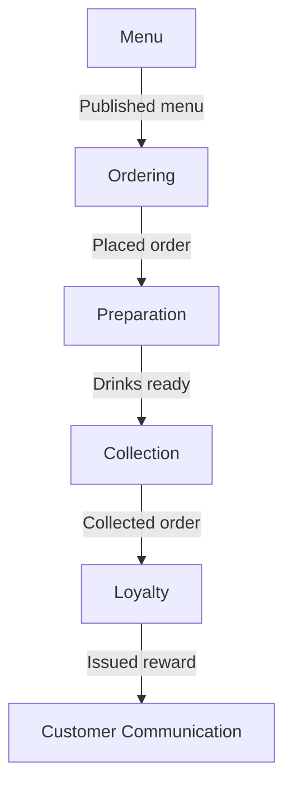

# Strategic DDD: language and ownership

Domain-driven design connects software design to a shared understanding of the
business. Strategic design identifies the models a system needs, their boundaries
and their relationships. The purpose is to make business meaning explicit enough
that people can discuss and change the software coherently.

## Domain, subdomain and ubiquitous language

The **domain** is the area of activity being modelled. For the café it includes
selling, preparing and handing over drinks. A **subdomain** is a distinct part of
that problem, such as menu management or customer loyalty.

DDD distinguishes core subdomains, which deserve particular modelling investment,
supporting subdomains and generic capabilities. Classification depends on the
organisation's strategy. Loyalty might distinguish one café chain while being a
standard purchased service for another.

A **ubiquitous language** is the vocabulary used consistently in conversations,
examples and software within a model. Record the meaning of “placed”, “ready” and
“collected”, including the conditions under which each becomes true. Eric Evans's
[DDD reference](https://www.domainlanguage.com/wp-content/uploads/2016/05/DDD_Reference_2015-03.pdf)
provides the underlying strategic and tactical vocabulary.

In this café, an operator can change a draft order. Placement freezes its
contents. Preparation becoming ready permits a pickup to open; collection
records physical handover. A single ambiguous `status = done` would hide these
different business facts.

## Bounded contexts

A **bounded context** defines where a particular model and language apply. The
same real-world occurrence can have different useful representations in different
contexts. Fowler's [Bounded Context](https://martinfowler.com/bliki/BoundedContext.html)
explains why larger systems often need several models.

| Context                | Its model and responsibility                               |
| ---------------------- | ---------------------------------------------------------- |
| Menu                   | Published drinks and complete priced menu editions         |
| Ordering               | An Order containing the customer's chosen lines            |
| Preparation            | A PreparationTicket describing work to perform             |
| Collection             | A Pickup and the conditions for handing it over            |
| Loyalty                | An account's credits, earned grants and redeemable rewards |
| Customer Communication | A notification intent and its delivery outcome             |

Ordering's Order and Preparation's ticket refer to the same purchase but answer
different questions. Ordering owns what was accepted. Preparation owns whether
the drinks are queued, being prepared or ready. Their identifiers connect the
workflow without making either model a shared mutable object.

## Context maps and translation

A **context map** records relationships between model boundaries. An upstream
context supplies something a downstream context consumes; this describes a
dependency, not organisational superiority. A published language is an agreed
interchange vocabulary. An **anti-corruption layer** translates that vocabulary
into the consumer's model, protecting its terminology and rules.

This is a simplified context map; the [full reference](../../README.md) shows
additional subscriptions. Each arrow is a published dependency. Consumers own
their local projections and translations.

The [OrderPlaced reaction](../../services/operations/src/operations/contexts/preparation/application/event_handlers/order_placed.py)
turns a published order into Preparation's `AcceptOrderCommand`. Its preparation
instructions are derived from the published lines. The consumer does not import
Ordering's aggregate implementation or read Ordering's database.

## Boundaries to keep distinct

A subdomain describes a business problem. A bounded context delimits a model.
A microservice is a deployment boundary. In this repository, each domain service
contains two contexts, and every context owns its database and credentials.

The useful boundary test is whether a team can explain who owns a decision,
which language applies, and which published contract another context may rely
on. A folder name alone provides little evidence of that ownership.

**Try it:** describe “order” from the counter operator's and barista's
perspectives. List which facts each needs and which decisions each may make.
Then compare [Ordering](../../services/storefront/contexts/ordering/README.md)
and [Preparation](../../services/operations/src/operations/contexts/preparation/README.md).

Next: [Tactical DDD](tactical-ddd.md).
