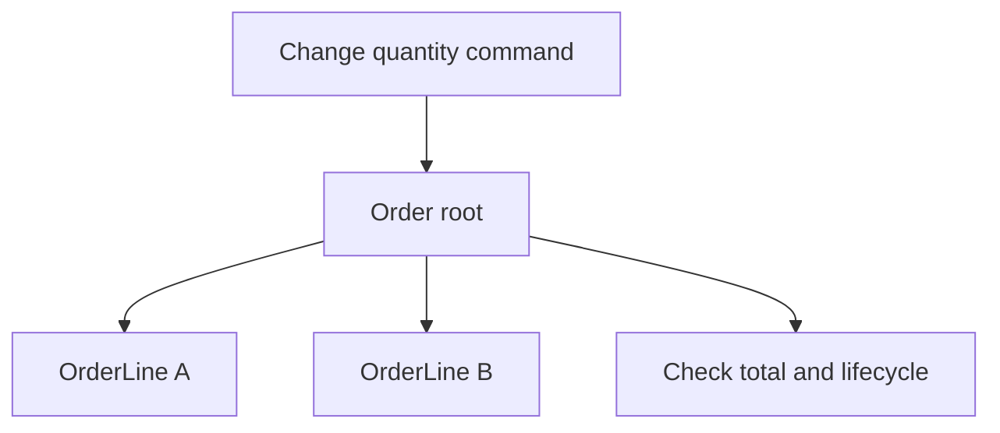

# Tactical DDD: behaviour and consistency

Tactical DDD provides building blocks for implementing a domain model. Start
with the decisions and rules, then choose the objects needed to express them.
The café's [domain rules](../../DDD.md) are the implementation reference for the
examples below.

## Entities and value objects

An **entity** has continuity of identity. An OrderLine remains the same line when
its quantity changes. Its current attributes describe that entity at a moment
in its lifecycle; they do not define its identity.

A **value object** is identified by its meaning and values. Two independently
constructed prices with the same amount and currency can represent the same
value. Replacing a value preserves clarity: a revised price is a new value,
whereas an Order continues as the same entity.

The café's MenuOffer freezes a published drink revision and its terms inside a
MenuEdition. It has no independent repository. This allows a historical menu to
retain the agreed price even after a Drink publishes a later revision.

## Aggregates, roots and invariants

An **aggregate** groups state whose immediate rules are controlled through one
root. An **invariant** is a condition that must hold at the business boundary
where it applies. Fowler's [aggregate overview](https://martinfowler.com/bliki/DDD_Aggregate.html)
describes the root's role in protecting changes to the group.

The café permits an empty draft Order while it is being assembled. Every line
edit enforces a combined maximum of five drinks. Placement additionally requires
at least one drink and freezes the contents. An invariant can therefore depend
on lifecycle state.

Allowing independent writes to OrderLine A and OrderLine B would make the combined
quantity rule harder to protect. The root checks the complete relevant state.
Two simultaneous line edits still compete for one Order revision.

The [Order implementation](../../services/storefront/contexts/ordering/domain/order.go)
and [its tests](../../services/storefront/contexts/ordering/domain/order_test.go)
show the actual behaviour. Aggregate design concerns business consistency;
database tables may be arranged differently by the persistence adaptor.

## Separate lifecycles

The LoyaltyAccount records credits and atomically earns a grant when three
eligible collections have accumulated. A Reward is issued from that grant in a
later transaction. The account's consistency boundary protects the entitlement;
the Reward owns its own issuance and redemption lifecycle.

An earned grant awaiting issuance is an explicit permitted state. If the business
required the voucher to exist immediately with the credit, the aggregate model
and transaction boundary would need reconsideration. A reference between two
objects alone does not require a shared aggregate.

## Repositories, factories and services

| Building block                      | Responsibility                                                            | Café example                                          |
| ----------------------------------- | ------------------------------------------------------------------------- | ----------------------------------------------------- |
| Repository                          | Load and save an aggregate through a collection-like boundary             | `OrderWriteRepository`                                |
| Factory or named creation operation | Establish valid initial state                                             | `LoyaltyAccount.open`                                 |
| Domain service                      | Express domain behaviour that has no natural entity or value-object owner | A hypothetical pricing policy spanning several values |
| Application service or handler      | Coordinate a use case using domain behaviour and ports                    | `CreditCollectionCommandHandler`                      |
| Domain event                        | Record a fact in the owner's business language                            | A reward grant was earned                             |

The pricing-policy example is conceptual; this reference has no separate pricing
service. A domain service still follows domain dependency rules. Network calls,
database transactions and container resolution belong outside the domain.

The [credit handler](../../services/engagement/src/contexts/loyalty/application/commands/credit-collection.ts)
loads or opens an account, calls its behaviour, saves it and returns the result.
The [account](../../services/engagement/src/contexts/loyalty/domain/loyalty-account.ts)
owns the credit and grant rules. The central executor owns transaction and receipt
bookkeeping. This split makes the business rule discoverable without requiring
the reader to understand RabbitMQ or PostgreSQL first.

## Model quality

An anemic domain model stores business data while placing most rules in unrelated
procedural services. For a complex invariant, that arrangement can spread the
same decision across several callers. Keep the rule behind a meaningful operation
such as `place` or `redeem`, and test its accepted and rejected transitions.

Use simpler transaction scripts when the business behaviour is simple. Tactical
patterns earn their cost by making important rules easier to understand and keep
consistent.

**Try it:** explain why an OrderLine belongs inside Order while a Reward has an
independent root. Use an invariant and a lifecycle as evidence for each choice.

Next: [Hexagonal architecture](hexagonal-architecture.md).
